# ÔN TẬP AN TOÀN THÔNG TIN – LESSON 01 ĐẾN LESSON 04

> **Mục tiêu:** Nắm được ý chính, hiểu các thuật ngữ thường gặp và biết cách tự bảo vệ tài khoản, máy tính cũng như mã nguồn khi học lập trình.
>
> **Cách học:** Đọc phần tóm tắt trước, xem bảng ghi nhớ, cuối cùng nhìn mindmap để nối kiến thức giữa 4 bài.

---

## 1. Bức tranh chung

| Bài | Nội dung chính | Cần nhớ |
|---|---|---|
| **Lesson 01** | Phishing, phần mềm crack và mã độc | Đừng mở file/link đáng ngờ; luôn hiện phần mở rộng file; quét file lạ trước khi dùng. |
| **Lesson 02** | Password Manager | Mỗi tài khoản một mật khẩu riêng; dùng két mật khẩu như Bitwarden; kiểm tra đúng tên miền trước khi đăng nhập. |
| **Lesson 03** | Xác thực 2 bước (2FA/MFA) | Mật khẩu có thể bị lộ, nên cần thêm lớp xác thực; lưu mã khôi phục cẩn thận. |
| **Lesson 04** | Bảo vệ API Key, SSH Key và secrets | Không ghi khóa bí mật vào code; dùng `.env` và `.gitignore`; key đã lộ thì phải thu hồi và tạo key mới. |

**Ý tưởng xuyên suốt:** Bảo vệ tài khoản và dự án bằng nhiều lớp. Không có một công cụ nào giải quyết được tất cả rủi ro.

---

# 2. Lesson 01 – Developer và các rủi ro bảo mật cơ bản

## 2.1. Vì sao lập trình viên dễ trở thành mục tiêu?

Máy tính của lập trình viên thường có nhiều thứ quan trọng hơn tài liệu cá nhân thông thường, chẳng hạn:

- **Mã nguồn dự án** và dữ liệu nội bộ.
- **SSH Key** để truy cập máy chủ.
- **API Key** để kết nối các dịch vụ như cloud hoặc API của bên thứ ba.
- Tài khoản GitHub, email và các công cụ làm việc.

Nếu máy tính bị chiếm quyền, kẻ xấu có thể lấy thông tin đăng nhập, truy cập máy chủ hoặc lợi dụng máy của lập trình viên để phát tán mã độc vào dự án. Rủi ro này có thể lan thành **Supply Chain Attack** (tấn công chuỗi cung ứng phần mềm).

## 2.2. Hai con đường lây nhiễm phổ biến

**Phishing (lừa đảo):** Kẻ xấu giả làm khách hàng, nhà tuyển dụng hoặc dịch vụ quen thuộc như GitHub, Google. Chúng gửi email/tin nhắn có đường link giả để dụ người dùng đăng nhập hoặc tải file.

**Phần mềm crack:** Phần mềm bẻ khóa thường bị chỉnh sửa hoặc gắn thêm mã độc. Những trang hướng dẫn yêu cầu tắt Windows Defender/Antivirus để cài đặt là dấu hiệu rất đáng nghi.

## 2.3. Bốn loại mã độc cần thuộc

| Tên mã độc | Hiểu đơn giản | Tác hại thường gặp |
|---|---|---|
| **Infostealer** | Mã độc chuyên ăn cắp thông tin | Lấy mật khẩu lưu trong trình duyệt, cookie đăng nhập, ví điện tử hoặc SSH Key. |
| **Keylogger** | Phần mềm ghi lại phím bấm | Có thể thu thập mật khẩu và nội dung người dùng gõ. |
| **Ransomware** | Mã độc tống tiền | Mã hóa/khóa dữ liệu rồi đòi tiền để đổi lấy khả năng khôi phục. |
| **CryptoMiner** | Mã độc đào tiền điện tử | Chiếm tài nguyên CPU/GPU, khiến máy chậm, nóng và hao điện. |

**Mẹo nhớ:** Infostealer = lấy dữ liệu; Keylogger = ghi phím; Ransomware = khóa dữ liệu; CryptoMiner = chiếm máy để đào coin.

## 2.4. Bẫy đuôi file kép (Double Extension)

Ví dụ tên file:

```text
Thong_bao.pdf.exe
```

Đuôi thực sự của file là `.exe`, tức file có thể chạy chương trình. Nếu Windows đang ẩn phần mở rộng đã biết, người dùng có thể chỉ nhìn thấy `Thong_bao.pdf` và tưởng đó là tài liệu PDF.

**Cách phòng tránh:**

- Bật **File name extensions** trong File Explorer để nhìn thấy đuôi file thật.
- Không mở file lạ chỉ vì biểu tượng trông giống Word/PDF.
- Kiểm tra người gửi và nguồn tải trước khi mở.

## 2.5. Công cụ kiểm tra

- **VirusTotal:** Dùng để kiểm tra file hoặc đường link bằng nhiều công cụ bảo mật.
- **Sandbox:** Môi trường cô lập để phân tích/chạy thử file đáng ngờ mà hạn chế ảnh hưởng tới máy thật.

## 2.6. Nên làm và tránh làm

**Nên:**
- Hiện phần mở rộng file.
- Kiểm tra kỹ tên miền trước khi đăng nhập.
- Dùng phần mềm chính hãng hoặc bản quyền giáo dục.
- Quét file đáng ngờ bằng công cụ phù hợp; chỉ thử nghiệm trong môi trường cô lập.

**Tránh:**
- Mở file đính kèm lạ chỉ vì biểu tượng quen mắt.
- Bấm link rút gọn hoặc link khẩn cấp từ người gửi không rõ.
- Cài phần mềm crack và tắt antivirus theo hướng dẫn.
- Chạy script tải trên mạng/AI tạo ra khi chưa đọc và hiểu nó.

---

# 3. Lesson 02 – Quản lý mật khẩu bằng Password Manager

## 3.1. Vì sao không nên dùng một mật khẩu cho mọi tài khoản?

Giả sử mày dùng cùng một mật khẩu cho diễn đàn, email và GitHub. Nếu diễn đàn bị rò rỉ dữ liệu, kẻ xấu có thể dùng email/mật khẩu đó thử đăng nhập vào các dịch vụ khác. Cách tấn công này gọi là **Credential Stuffing**.

**Cách giải quyết:** Mỗi tài khoản dùng một mật khẩu riêng, dài và khó đoán. Vì khó nhớ hàng chục mật khẩu khác nhau nên dùng **Password Manager** (trình quản lý mật khẩu), ví dụ Bitwarden.

## 3.2. Password Manager hoạt động thế nào?

Có thể hình dung nó như một chiếc két sắt:

1. Người dùng tạo **Master Passphrase** để mở két.
2. Các mật khẩu được lưu trong **Vault** (két mật khẩu).
3. Dữ liệu được mã hóa trên thiết bị trước khi đồng bộ lên máy chủ.
4. Khi cần đăng nhập, công cụ có thể tự điền thông tin đã lưu.

Theo tài liệu bài học, Bitwarden sử dụng mã hóa **AES-256** và cơ chế dẫn xuất khóa **PBKDF2 SHA-256** với 600.000 vòng lặp. Điểm quan trọng của kiến trúc **Zero-Knowledge** là nhà cung cấp lưu dữ liệu đã mã hóa và không có cách đọc trực tiếp mật khẩu trong Vault của người dùng.

> Nói dễ hiểu: máy chủ giữ chiếc két đã khóa, còn khả năng mở két nằm ở phía người dùng. Đây là cách giảm rủi ro, không có nghĩa là tài khoản miễn nhiễm với mọi kiểu tấn công.

## 3.3. Bốn việc nên làm khi dùng Password Manager

- **Master Passphrase:** Tạo cụm mật khẩu đủ dài, có thể ghép 3–4 từ ngẫu nhiên dễ nhớ. Đây là chìa khóa chính, phải giữ kín và không dùng lại ở nơi khác.
- **Mã hóa Vault:** Cài ứng dụng/tiện ích chính thức và bảo vệ kho mật khẩu bằng Master Passphrase.
- **Password Generator:** Tạo mật khẩu ngẫu nhiên dài khoảng 20 ký tự trở lên, gồm chữ hoa, chữ thường, số và ký tự đặc biệt; mỗi website dùng một mật khẩu khác nhau.
- **Auto-fill:** Dùng tính năng tự động điền thay vì ghi mật khẩu ra giấy hoặc copy-paste tùy tiện. Phím tắt được bài học nêu là `Ctrl + Shift + L` trên Windows và `Cmd + Shift + L` trên macOS.

## 3.4. Auto-fill giúp chống Phishing như thế nào?

Bitwarden đối chiếu tên miền website hiện tại với tên miền đã lưu trong Vault. Nếu trang đang mở không khớp, công cụ có thể từ chối tự điền mật khẩu.

Ví dụ: trang giả mạo có tên gần giống `github.com` nhưng thực tế là một tên miền khác. Việc Auto-fill không hoạt động là dấu hiệu để dừng lại và kiểm tra URL.

**Lưu ý:** Auto-fill là một lớp hỗ trợ, không thay thế việc tự kiểm tra địa chỉ website.

## 3.5. Thói quen tốt

- Dùng mật khẩu riêng, ngẫu nhiên cho từng website.
- Giữ Master Passphrase bí mật; không dán lên màn hình hoặc lưu trong file văn bản công khai.
- Kiểm tra đúng tên miền trước khi đăng nhập.
- Khóa Vault khi không sử dụng; bài học đưa ví dụ Vault Timeout sau 15 phút.
- Sao lưu Vault ở định dạng **đã mã hóa** và cất giữ an toàn.
- Không gửi mật khẩu qua email hoặc nhóm chat thông thường; dùng tính năng chia sẻ an toàn có thời hạn khi cần.

---

# 4. Lesson 03 – Xác thực hai bước (2FA/MFA)

## 4.1. 2FA là gì?

**2FA (Two-Factor Authentication)** là cách đăng nhập cần hai yếu tố xác thực khác loại. Mục đích là thêm một lớp bảo vệ trong trường hợp mật khẩu bị lộ.

Ba nhóm yếu tố xác thực cơ bản:

| Nhóm | Ý nghĩa | Ví dụ |
|---|---|---|
| **Know / Knowledge** | Điều mày biết | Mật khẩu, mã PIN. |
| **Have / Possession** | Thứ mày có | Điện thoại có Authenticator, khóa bảo mật YubiKey. |
| **Are / Inherence** | Đặc điểm của chính mày | Vân tay, nhận diện khuôn mặt. |

- **2FA:** Dùng hai yếu tố.
- **MFA:** Khái niệm rộng hơn, dùng từ hai yếu tố trở lên.

Ví dụ: Mật khẩu + mã từ Authenticator là hai yếu tố khác nhóm.

## 4.2. SMS OTP và Authenticator App

**SMS OTP:** Mã xác thực được gửi qua tin nhắn điện thoại. Cách này tiện nhưng có rủi ro như tráo SIM (SIM Swapping) hoặc chiếm đoạt tin nhắn.

**Authenticator App:** Ứng dụng tự tạo mã trên thiết bị dựa vào khóa bí mật đã thiết lập và thời gian hiện tại. Vì không cần nhận SMS nên tránh được một số rủi ro liên quan đến SIM và mạng viễn thông.

**Kết luận:** Với tài khoản quan trọng, nên ưu tiên ứng dụng Authenticator hoặc khóa bảo mật phần cứng khi dịch vụ hỗ trợ. Authenticator vẫn không chống được mọi kiểu phishing, vì vậy phải cẩn thận với trang đăng nhập giả.

## 4.3. TOTP hoạt động ra sao?

**TOTP (Time-based One-Time Password)** là mã dùng một lần được tạo dựa trên thời gian. Quy trình theo bài học gồm 4 bước:

1. **Shared Secret Key:** Khi bật 2FA, máy chủ cung cấp khóa bí mật thường được biểu diễn bằng QR code. Điện thoại quét QR và lưu khóa.
2. **Timestamp:** Điện thoại và máy chủ dựa vào thời gian hiện tại, chia thành từng khoảng 30 giây để tính cùng một mốc thời gian.
3. **HMAC-SHA1:** Khóa bí mật và mốc thời gian được đưa qua thuật toán HMAC-SHA1 để tạo kết quả băm.
4. **Mã OTP:** Ứng dụng rút ra mã thường gồm 6 chữ số. Mã thay đổi theo chu kỳ 30 giây.

**Mẹo nhớ:** QR lưu khóa bí mật → thời gian 30 giây → HMAC-SHA1 → mã 6 số.

## 4.4. Recovery Codes (mã khôi phục)

Recovery Codes là các mã dự phòng dùng khi không thể truy cập phương thức 2FA chính, ví dụ mất điện thoại hoặc đổi thiết bị.

Nên:
- Lưu mã khôi phục trong nơi an toàn, ví dụ Secure Note của Password Manager hoặc bản giấy cất kín.
- Thiết lập phương án sao lưu Authenticator phù hợp.
- Không đăng ảnh mã khôi phục lên mạng hoặc gửi vào nhóm chat công khai.
- Bật 2FA cho các tài khoản quan trọng như GitHub, GitLab, email và dịch vụ cloud.

**Điểm cần nhớ:** Đừng bật 2FA xong rồi bỏ qua Recovery Codes. Mất cả điện thoại lẫn mã dự phòng thì việc lấy lại tài khoản có thể rất phiền phức.

---

# 5. Lesson 04 – Quản lý và bảo mật Secrets trong lập trình

## 5.1. Secrets là gì?

**Secrets** là thông tin bí mật dùng để xác thực hoặc cấp quyền truy cập hệ thống, ví dụ:

- API Key của dịch vụ như cloud hoặc AI.
- Mật khẩu cơ sở dữ liệu.
- SSH Private Key.
- Secret Key của cổng thanh toán.

**API Key** giúp dịch vụ nhận diện ứng dụng/yêu cầu gọi API và kiểm soát việc truy cập theo cấu hình quyền. Key có quyền truy cập hoặc phát sinh chi phí phải được bảo vệ như mật khẩu.

## 5.2. Hardcode Secrets nguy hiểm thế nào?

**Hardcode Secrets** là ghi trực tiếp API Key, mật khẩu database hoặc khóa riêng tư vào code, ví dụ đặt thẳng trong `app.js` hay `main.py`.

Việc này nguy hiểm vì:
- Khi đẩy repository lên GitHub công khai, người khác có thể nhìn thấy key.
- **Scraper Bot** có thể tự động quét repository để tìm chuỗi khóa bị lộ.
- Kẻ xấu có thể dùng key để truy cập dịch vụ, đọc dữ liệu hoặc phát sinh chi phí.
- Git lưu lịch sử commit. Xóa dòng chứa key ở commit mới **không đồng nghĩa** key đã biến mất khỏi lịch sử cũ.

## 5.3. Phân biệt `.env`, `.gitignore` và `.env.example`

| Tệp | Dùng để làm gì? | Có đưa lên Git không? |
|---|---|---|
| **`.env`** | Lưu giá trị thật của biến môi trường trên máy cá nhân/môi trường chạy. | Không. |
| **`.gitignore`** | Báo cho Git bỏ qua những file/thư mục không được theo dõi. | Có. |
| **`.env.example`** | File mẫu chỉ ghi tên biến và giá trị minh họa/rỗng để người khác biết cần cấu hình gì. | Có, miễn là không chứa key thật. |

Ví dụ `.env` trên máy cá nhân:

```env
DB_PASSWORD=gia_tri_bi_mat_cua_may
OPENAI_API_KEY=key_that_cua_may
```

Ví dụ `.env.example` đưa lên repository:

```env
DB_PASSWORD=
OPENAI_API_KEY=your_key_here
```

Ví dụ `.gitignore`:

```gitignore
.env
.env.local
.env.*.local
```

Trong code, chương trình đọc biến môi trường thay vì ghi cứng giá trị bí mật. Ví dụ với Node.js:

```js
const apiKey = process.env.OPENAI_API_KEY;
```

Có thể dùng thư viện `dotenv` để nạp biến từ file `.env` trong môi trường phát triển.

> **Cực kỳ quan trọng:** `.gitignore` chủ yếu ngăn Git theo dõi file chưa được đưa vào Git. Nếu `.env` đã được commit trước đó, thêm nó vào `.gitignore` không tự xóa file khỏi lịch sử. Phải xử lý việc ngừng theo dõi file và đặc biệt là thu hồi key đã lộ.

## 5.4. Nếu lỡ làm lộ API Key thì làm gì?

1. **Revoke (thu hồi) key bị lộ** trên trang quản lý của nhà cung cấp.
2. **Tạo key mới** và cập nhật vào môi trường chạy an toàn.
3. Kiểm tra lịch sử truy cập, hoạt động bất thường và chi phí phát sinh.
4. Xử lý repository/lịch sử Git theo quy trình của dự án, nhưng đừng nhầm việc xóa dòng code với việc key cũ đã an toàn. Key đã lộ phải được xem là không còn bí mật.

## 5.5. Công cụ và cách bảo vệ nâng cao

- **Secret Scanning:** Tự động quét repository để tìm chuỗi có vẻ là key hoặc thông tin bí mật.
- **GitHub Push Protection:** Có thể chặn thao tác push khi phát hiện secret thuộc các mẫu được hỗ trợ.
- **Gitleaks:** Công cụ quét secrets trong repository; có thể tích hợp vào quy trình kiểm tra trước khi push.
- **Secrets Manager / Key Vault / HashiCorp Vault:** Dịch vụ quản lý và cấp phát bí mật tập trung.
- **IAM Roles:** Cấp quyền cho dịch vụ/máy chủ theo vai trò, hạn chế việc phải nhúng key tĩnh vào code.

Với cổng thanh toán, cần phân biệt **Publishable Key** (có thể dùng ở phía client theo thiết kế của nhà cung cấp) và **Secret Key** (chỉ sử dụng ở backend, không đưa vào trình duyệt hay ứng dụng client).

---

# 6. Mindmap tổng hợp 4 bài

Sơ đồ Mermaid dưới đây có thể xem trực tiếp trên nền tảng hỗ trợ Mermaid, ví dụ GitHub hoặc một số trình soạn thảo Markdown.

```mermaid
flowchart TD
    A((AN TOÀN THÔNG TIN))

    A --> B[Lesson 01: Phòng mã độc]
    A --> C[Lesson 02: Quản lý mật khẩu]
    A --> D[Lesson 03: Xác thực 2FA/MFA]
    A --> E[Lesson 04: Bảo vệ Secrets]

    B --> B1[Phishing và phần mềm crack]
    B --> B2[Infostealer / Keylogger]
    B --> B3[Ransomware / CryptoMiner]
    B --> B4[Hiện đuôi file]
    B --> B5[VirusTotal / Sandbox]

    C --> C1[Credential Stuffing]
    C --> C2[Password Manager: Bitwarden]
    C --> C3[Master Passphrase]
    C --> C4[Vault mã hóa AES-256]
    C --> C5[Mật khẩu riêng 20+ ký tự]
    C --> C6[Auto-fill kiểm tra Domain]

    D --> D1[Know / Have / Are]
    D --> D2[Authenticator App]
    D --> D3[TOTP: QR + Secret Key]
    D --> D4[HMAC-SHA1 + mã 6 số]
    D --> D5[Chu kỳ 30 giây]
    D --> D6[Recovery Codes]

    E --> E1[Secrets: API Key / DB / SSH]
    E --> E2[Không Hardcode]
    E --> E3[.env lưu key thật]
    E --> E4[.gitignore bỏ qua .env]
    E --> E5[.env.example làm file mẫu]
    E --> E6[Secret Scanning / Gitleaks]
    E --> E7[Lộ key: Revoke và tạo key mới]
```



## 6.1. Mindmap dạng chữ để học nhanh

```text
AN TOÀN THÔNG TIN
|
+-- 1. PHÒNG MÃ ĐỘC
|   +-- Phishing, phần mềm crack
|   +-- Infostealer: ăn cắp dữ liệu
|   +-- Keylogger: ghi phím
|   +-- Ransomware: khóa dữ liệu
|   +-- CryptoMiner: chiếm CPU/GPU
|   +-- Hiện đuôi file, VirusTotal, Sandbox
|
+-- 2. QUẢN LÝ MẬT KHẨU
|   +-- Không tái sử dụng mật khẩu
|   +-- Credential Stuffing
|   +-- Password Manager / Bitwarden
|   +-- Master Passphrase mở Vault
|   +-- Mỗi tài khoản một mật khẩu ngẫu nhiên
|   +-- Auto-fill kiểm tra tên miền
|
+-- 3. XÁC THỰC 2 BƯỚC
|   +-- Know: mật khẩu/PIN
|   +-- Have: điện thoại/YubiKey
|   +-- Are: vân tay/FaceID
|   +-- Authenticator tạo TOTP
|   +-- Mã 6 số, đổi sau 30 giây
|   +-- Lưu Recovery Codes
|
+-- 4. BẢO VỆ SECRETS
    +-- API Key, DB Password, SSH Private Key
    +-- Không Hardcode vào source code
    +-- .env: lưu giá trị thật
    +-- .gitignore: chặn Git theo dõi .env
    +-- .env.example: file mẫu không có key thật
    +-- Secret Scanning / Push Protection / Gitleaks
    +-- Lộ key: thu hồi, tạo key mới, kiểm tra log
```

---

# 7. Những cặp khái niệm dễ nhầm

| Khái niệm | Phân biệt nhanh |
|---|---|
| **Phishing** và **Malware** | Phishing là cách lừa người dùng; malware là phần mềm độc hại. Phishing có thể dụ người dùng tải/chạy malware hoặc nhập mật khẩu. |
| **Infostealer** và **Keylogger** | Infostealer tập trung lấy dữ liệu có sẵn; Keylogger ghi lại thao tác gõ phím. |
| **Password Manager** và **Authenticator** | Password Manager quản lý mật khẩu; Authenticator tạo mã xác thực 2FA. Một số ứng dụng có thể tích hợp cả hai chức năng. |
| **2FA** và **MFA** | 2FA dùng đúng hai yếu tố; MFA là xác thực nhiều yếu tố, từ hai yếu tố trở lên. |
| **OTP** và **TOTP** | OTP là mã dùng một lần nói chung; TOTP là loại OTP được tạo dựa trên thời gian. |
| **`.env`** và **`.env.example`** | `.env` chứa giá trị thật; `.env.example` chỉ hướng dẫn tên biến cần cấu hình. |
| **`.gitignore`** và xóa file | `.gitignore` ngăn Git theo dõi file phù hợp, nhưng không tự xóa file đã được commit khỏi lịch sử. |
| **API Key** và **Secret Key** | API Key là khái niệm khóa truy cập API; Secret Key là loại khóa cần giữ kín. Không phải mọi key đều có cùng mức độ công khai. |

---

# 8. Checklist trước khi code và đẩy Git

- [ ] Máy đã bật hiển thị phần mở rộng file.
- [ ] Không cài phần mềm crack hoặc tắt antivirus để cài file lạ.
- [ ] Đã kiểm tra tên miền trước khi nhập tài khoản/mật khẩu.
- [ ] Mỗi tài khoản dùng mật khẩu riêng trong Password Manager.
- [ ] Đã bật 2FA cho các tài khoản quan trọng.
- [ ] Đã lưu Recovery Codes ở nơi an toàn.
- [ ] Đã tạo `.gitignore` trước lần `git add` đầu tiên.
- [ ] `.env` và các file chứa key thật không nằm trong Git.
- [ ] `.env.example` không chứa giá trị bí mật thật.
- [ ] Đã quét secrets trước khi push nếu dự án có thiết lập công cụ.
- [ ] Nếu key bị lộ, đã thu hồi và tạo key mới.

---

# 9. Ghi nhớ siêu nhanh trước khi kiểm tra

1. **4 mã độc:** Infostealer – Keylogger – Ransomware – CryptoMiner.
2. **File name extensions:** Hiện đuôi file thật để tránh bẫy `.pdf.exe`.
3. **Credential Stuffing:** Lấy cặp email/mật khẩu bị rò rỉ để thử đăng nhập nơi khác.
4. **Zero-Knowledge:** Dữ liệu được mã hóa phía người dùng; nhà cung cấp không đọc trực tiếp được Vault.
5. **Master Passphrase:** Chìa khóa chính để mở kho mật khẩu.
6. **2FA:** Thêm yếu tố xác thực thứ hai ngoài mật khẩu.
7. **TOTP:** Mã dựa trên thời gian, thường 6 số và đổi theo chu kỳ 30 giây.
8. **Recovery Codes:** Mã dự phòng khi mất phương thức 2FA chính.
9. **Hardcode Secrets:** Ghi key/mật khẩu thẳng vào code, rất dễ lộ.
10. **`.env` + `.gitignore`:** Lưu key thật ở `.env`, ngăn Git đưa file đó lên repository.
11. **`.env.example`:** File mẫu để đồng đội biết cần khai báo biến nào.
12. **Lộ key:** Thu hồi key cũ, tạo key mới và kiểm tra hoạt động bất thường.

**Kết luận:** Đừng chỉ cố viết code chạy được. Hãy giữ máy sạch, mật khẩu riêng, tài khoản có 2FA và secrets nằm ngoài mã nguồn. Đó là nền tảng bảo mật tối thiểu của một lập trình viên.
