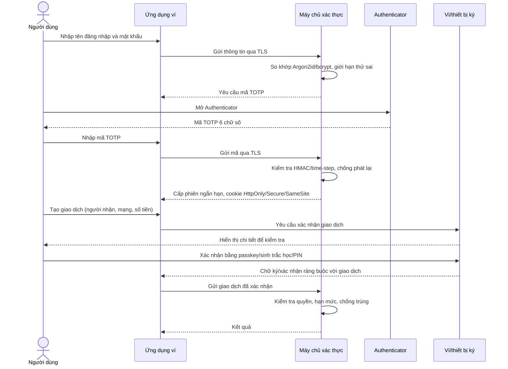

# Bài 5: Xây dựng cơ chế xác thực an toàn cho Crypto Wallet

## 1. Kiến trúc đề xuất

Ba lớp bảo vệ được dùng là:

1. **Mật khẩu mạnh** – kiến thức người dùng biết. Mật khẩu được lưu dưới dạng hàm băm thích nghi (Argon2id hoặc bcrypt), kèm salt riêng; không lưu mật khẩu thuần.
2. **Thiết bị xác thực TOTP** – vật sở hữu của người dùng. Ứng dụng Authenticator tạo mã 6 chữ số từ khóa bí mật riêng và thời gian hiện tại theo RFC 6238. Mã thường có hiệu lực 30 giây.
3. **Xác nhận giao dịch theo ngữ cảnh** – sau khi đăng nhập, giao dịch rủi ro cao cần xác nhận độc lập trên thiết bị đã đăng ký, hiển thị rõ người nhận, mạng blockchain và số tiền. Ưu tiên khóa truy cập/passkey hoặc chữ ký khóa riêng được bảo vệ trong Secure Enclave/keystore; không gửi khóa riêng lên máy chủ.

MFA ở bước đăng nhập là mật khẩu + TOTP (hai yếu tố khác loại). Lớp thứ ba tăng khả năng bảo vệ tài sản: chiếm được phiên đăng nhập cũng chưa đủ để tự ý chuyển tiền. Nếu chỉ yêu cầu mật khẩu và TOTP, cần mô tả chính xác đó là hai yếu tố MFA; lớp thứ ba là kiểm soát xác nhận giao dịch.

## 2. Sơ đồ luồng dữ liệu

## 3. Cách các lớp ngăn chặn tấn công

- Mật khẩu bị lộ riêng lẻ không đủ vì máy chủ tiếp tục yêu cầu TOTP.
- TOTP được tính trong Authenticator từ khóa bí mật đã cấp lúc bật MFA và bộ đếm thời gian. Máy chủ chỉ lưu khóa bí mật ở dạng mã hóa, giới hạn sai, chấp nhận cửa sổ thời gian nhỏ để bù lệch đồng hồ và đánh dấu mã đã dùng để chống phát lại.
- Kẻ lấy được mật khẩu và mã TOTP vẫn cần phê duyệt giao dịch trên thiết bị ký. Ứng dụng phải hiện thông tin giao dịch trên màn hình đáng tin cậy; chữ ký gắn với đúng nội dung giao dịch để không thể đổi người nhận/số tiền sau khi người dùng duyệt.
- Dùng TLS, thời hạn phiên ngắn, cookie an toàn, giới hạn tốc độ, thông báo đăng nhập lạ, nhật ký kiểm toán và quy trình thu hồi thiết bị. Không gửi mã TOTP qua email/SMS; TOTP chống được việc chiếm SIM nhưng vẫn có thể bị lừa qua trang phishing thời gian thực. Passkey/WebAuthn có khả năng chống phishing tốt hơn và có thể dùng bổ sung.

## 4. Khi người dùng không có Internet hoặc sóng điện thoại

TOTP không cần kết nối mạng hay sóng di động. Authenticator và máy chủ cùng biết khóa bí mật đã thiết lập trước đó và cùng tính mã dựa trên thời gian hiện tại. Người dùng chỉ cần mở ứng dụng Authenticator ngoại tuyến và nhập mã đang hiển thị. Cần đặt ngày giờ thiết bị tự động/đúng để giảm sai lệch.

Điều kiện: người dùng đã cài đặt và liên kết Authenticator trước khi ngoại tuyến, thiết bị còn hoạt động và giờ hệ thống tương đối chính xác. TOTP chỉ giải quyết việc tạo mã; để gửi giao dịch lên blockchain hoặc máy chủ vẫn cần kết nối mạng. Nếu chỉ cần ký giao dịch khi ngoại tuyến, ví có thể ký cục bộ rồi phát giao dịch sau khi có mạng.

### Mất thiết bị xác thực

Cấp trước các mã khôi phục dùng một lần, lưu ngoại tuyến an toàn. Khi dùng mã khôi phục phải thu hồi thiết bị cũ, gửi cảnh báo và yêu cầu xác minh bổ sung; không cho bỏ MFA chỉ bằng hỗ trợ khách hàng hoặc email. Nếu thay điện thoại, chuyển Authenticator trong quy trình có xác thực mạnh.

## 5. Quy trình bật TOTP an toàn

1. Người dùng nhập lại mật khẩu và xác nhận bước gần đây.
2. Máy chủ sinh secret ngẫu nhiên đủ mạnh, hiển thị QR `otpauth://` một lần qua HTTPS.
3. Người dùng quét QR rồi nhập mã hiện tại để xác nhận thiết lập.
4. Máy chủ lưu secret được mã hóa bằng khóa quản lý bí mật (KMS/HSM), không ghi secret hoặc mã OTP vào log.
5. Sinh mã khôi phục dùng một lần; lưu bản băm của từng mã và hướng dẫn cất an toàn.
6. Khi tắt/đổi MFA, yêu cầu xác thực lại, thông báo qua kênh đã đăng ký và ghi nhật ký.

## 6. Kết luận

Thiết kế kết hợp mật khẩu, TOTP ngoại tuyến và xác nhận giao dịch riêng trên thiết bị ký. Mật khẩu + TOTP là MFA; xác nhận gắn với giao dịch là lớp kiểm soát bổ sung bảo vệ tài sản kể cả khi thông tin đăng nhập bị lộ.
