# IT-101 – Tổng ôn nhanh: Excel, VLOOKUP và PowerPoint

> Phạm vi: 3 bài đọc trong `SS11.zip` — **Excel/Sheets: Tư duy Database & AutoFilter**, **Excel/Sheets: VLOOKUP**, **PowerPoint/Slides: Thiết kế báo cáo kỹ thuật trực quan**.

## 1. Tờ phao 60 giây

| Chủ đề | Phải nhớ | Bẫy dễ mất điểm |
|---|---|---|
| **Database & AutoFilter** | Hàng = **Record** (một đối tượng); cột = **Field** (một thuộc tính). `Ctrl + Shift + L` bật/tắt Filter. | Dòng trống làm đứt vùng dữ liệu; tiêu đề gộp ô (`Merge Cells`) làm Filter nhận diện sai; không để dòng tổng ở giữa dữ liệu. |
| **VLOOKUP** | `=VLOOKUP(key, table, col, FALSE)`; cột đầu của vùng tra phải chứa key; `F4` khóa vùng bằng `$`; `IFERROR` xử lý lỗi. | Quên `$` khi kéo công thức; thiếu key; key có khoảng trắng thừa; cột key không nằm bên trái; bỏ `FALSE` khiến tra cứu gần đúng. |
| **PowerPoint** | Quy tắc **10/20/30**; tiêu đề kiểu **Assertion Title**; dùng biểu đồ dễ đọc, tương phản tốt và ít chữ. | Nhét nguyên bảng dài lên slide; biểu đồ 3D; chữ nhỏ/độ tương phản thấp; quay lưng đọc slide. |

---

## 2. Bài 1 – Excel/Sheets: Tư duy Database & AutoFilter

### Khái niệm cốt lõi

- **Record (bản ghi / hàng):** thông tin của **một đối tượng hoàn chỉnh**, ví dụ một sinh viên hoặc một đơn hàng.
- **Field (trường / cột):** **một thuộc tính** của đối tượng, ví dụ MSSV, Họ tên, Điểm.
- **Header:** hàng tiêu đề đặt tên cho các Field.
- **AutoFilter:** lọc các bản ghi theo điều kiện, không xóa dữ liệu gốc.

### Dùng AutoFilter

- Chọn một ô bên trong bảng → bấm **`Ctrl + Shift + L`** hoặc vào **Data → Filter**.
- Lọc chữ: **Text Filters** → `Contains...` hoặc chọn giá trị.
- Lọc số: **Number Filters** → `Greater Than...`, `Between...`.
- Có thể lọc nhiều cột cùng lúc, ví dụ `Department = Sales` **và** `Salary >= 40000`.

### 5 quy tắc giữ bảng dữ liệu sạch

1. **Một hàng tiêu đề rõ ràng**, không gộp ô.
2. **Một hàng = một đối tượng**.
3. Dữ liệu **nguyên tử**: tách Họ và Tên thành cột riêng khi cần sắp xếp/lọc.
4. **Không chèn hàng trống** giữa vùng dữ liệu.
5. Dòng `Total/Average` đặt **ngoài** vùng dữ liệu chính.

Làm sạch khoảng trắng: `=TRIM(A2)` loại khoảng trắng đầu/cuối và khoảng trắng thừa giữa các từ (giữ một dấu cách đơn giữa các từ). Dữ liệu có khoảng trắng vô hình có thể khiến lọc/so khớp không ra kết quả mong muốn.

### Phím tắt cần thuộc

- `Ctrl + Shift + L`: bật/tắt AutoFilter.
- `Alt + ↓`: mở menu dropdown Filter ở tiêu đề đang chọn.
- `Ctrl + T`: chuyển vùng dữ liệu thành Excel Table.
- `Ctrl + A`: chọn vùng dữ liệu liên tục hiện tại (ngữ cảnh trong bảng).

### Câu hỏi tự luận hay gặp

**Vì sao Filter mới lọc đến dòng 45 rồi dừng?** Hai nguyên nhân điển hình theo bài học:

1. Có **một hàng trống hoàn toàn** ở dòng 46 làm Excel tưởng vùng dữ liệu đã kết thúc.
2. **Hàng tiêu đề bị gộp ô (`Merge Cells`)** làm vùng dữ liệu bị nhận diện sai.

---

## 3. Bài 2 – Excel/Sheets: VLOOKUP và nối dữ liệu

### Cú pháp phải nhớ

```excel
=VLOOKUP(Lookup_value, Table_array, Col_index_num, Range_lookup)
```

| Tham số | Nghĩa | Ví dụ |
|---|---|---|
| `Lookup_value` | Giá trị khóa dùng để tìm | `G3` hoặc mã `SP01` |
| `Table_array` | Vùng chứa bảng tra; **cột đầu tiên phải có khóa** | `$A:$E` hoặc `Catalog!$A:$C` |
| `Col_index_num` | Số thứ tự cột cần trả về, tính từ **cột đầu của vùng tra** | `5` lấy cột thứ 5 |
| `Range_lookup` | Chế độ tra cứu | `FALSE` hoặc `0` = chính xác |

**Mẫu an toàn:**

```excel
=VLOOKUP(G3, $A:$E, 5, FALSE)
```

**Bọc lỗi nếu không tìm được mã:**

```excel
=IFERROR(VLOOKUP(G3, $A:$E, 5, FALSE), "Chưa có giá")
```

### Vai trò của F4 và dấu `$`

Khi kéo công thức xuống nhiều dòng, tham chiếu tương đối có thể làm vùng tra cứu dịch chuyển. Chọn vùng `Table_array` trong công thức rồi nhấn **`F4`** để chuyển thành tham chiếu tuyệt đối, ví dụ `A:E` → `$A:$E`. Như vậy vùng tra cứu được giữ nguyên khi kéo công thức.

### Checklist khi gặp `#N/A`

1. Mã cần tìm có thật trong bảng tra không?
2. Mã có **khoảng trắng thừa** không? Thử làm sạch bằng `TRIM`.
3. Cột chứa khóa có phải **cột ngoài cùng bên trái của `Table_array`** không? VLOOKUP không tra ngược từ phải sang trái.
4. `Table_array` có bị trôi vì quên `$` không?
5. Tham số cuối đã đặt `FALSE` hoặc `0` để tìm chính xác chưa?

### Các hàm liên quan

- `IFERROR(formula, fallback_value)`: thay kết quả lỗi bằng giá trị dự phòng.
- `XLOOKUP(key, lookup_col, return_col)`: hàm hiện đại, không cần đếm số thứ tự cột và linh hoạt hơn VLOOKUP.
- `INDEX` + `MATCH`: lựa chọn linh hoạt khi cần tra cứu từ phải sang trái.

### Mối liên hệ CNTT

VLOOKUP dùng mã khóa để lấy thông tin từ bảng khác, gần với ý tưởng **nối bảng (`JOIN`)** trong CSDL quan hệ/SQL. Chỉ cần hiểu đây là sự tương đồng về mục đích, không phải cú pháp giống nhau.

---

## 4. Bài 3 – PowerPoint/Slides: Thiết kế báo cáo trực quan

### Quy tắc 10/20/30 của Guy Kawasaki

- **10 slides tối đa**.
- **20 phút** cho bài trình bày.
- **30 pt tối thiểu** cho cỡ chữ theo quy tắc này.

Hãy xem đây là nguyên tắc cô đọng thông điệp, không phải luật cứng cho mọi tình huống.

### Assertion Title

**Assertion Title = tiêu đề là một câu kết luận/khẳng định**, không chỉ là tên chủ đề.

- Tiêu đề chủ đề: `Hiệu năng hệ thống`.
- Tiêu đề kết luận: `Tối ưu CSDL giúp giảm 65% thời gian phản hồi`.

Người xem chỉ nên cần vài giây để nắm được thông điệp chính. Slide hỗ trợ lời nói, không phải bản chép lời để người thuyết trình đọc nguyên văn. Lỗi nhồi chữ thường được gọi là **Death by PowerPoint**.

### Công thức bố cục một slide dữ liệu

1. **Header:** Assertion Title, nêu thông điệp.
2. **Content:** biểu đồ/ảnh/sơ đồ làm nổi bật một insight.
3. **Footer:** nguồn dữ liệu hoặc ghi chú cần thiết.

Nguyên tắc nhanh:

- Ưu tiên **biểu đồ cột/thanh** thay cho bảng số liệu quá dày.
- Tập trung vào **một insight chính** mỗi slide.
- Dùng khoảng **2 màu trung tính + 1 màu nhấn**.
- Chừa khoảng trắng để bố cục dễ thở; chữ đủ lớn và tương phản tốt.
- Tránh biểu đồ 3D gây méo cảm nhận dữ liệu, màu chữ/nền khó đọc, và đọc slide quay lưng với khán giả.

### Phím tắt PowerPoint

- `F5`: trình chiếu từ **slide đầu tiên**.
- `Shift + F5`: trình chiếu từ **slide hiện tại**.
- `B` hoặc `.`: làm đen màn hình khi đang trình chiếu.
- `W` hoặc `,`: làm trắng màn hình khi đang trình chiếu.
- `Ctrl + P`: bật bút để vẽ/khoanh trực tiếp trên slide khi đang trình chiếu (theo bảng phím tắt trong bài đọc).

---

## 5. Mindmap tổng hợp

```mermaid
flowchart TD
    A[IT-101: Tổng ôn nhanh]
    A --> B[Excel: Database & AutoFilter]
    A --> C[Excel: VLOOKUP]
    A --> D[PowerPoint: Slide trực quan]
    B --> B1[Record = hàng / đối tượng]
    B --> B2[Field = cột / thuộc tính]
    B --> B3[Ctrl+Shift+L: Filter]
    B --> B4[Không Merge / không hàng trống / không tổng giữa bảng]
    B --> B5[TRIM: làm sạch khoảng trắng]
    C --> C1[Key: giá trị cần tìm]
    C --> C2[Table_array: cột đầu có key]
    C --> C3[Col_index_num: cột trả về]
    C --> C4[FALSE/0: tìm chính xác]
    C --> C5[F4 → $ khóa vùng tra]
    C --> C6[IFERROR: xử lý lỗi]
    D --> D1[Rule 10 / 20 / 30]
    D --> D2[Assertion Title = câu kết luận]
    D --> D3[1 slide = 1 thông điệp]
    D --> D4[Biểu đồ rõ / chữ lớn / tương phản tốt]
    D --> D5[F5 đầu bài / Shift+F5 hiện tại]
```



---

## 6. Tự kiểm tra nhanh (che đáp án trước khi làm)

1. Record và Field khác nhau thế nào?
2. Phím tắt bật/tắt AutoFilter là gì?
3. Nêu hai lý do AutoFilter dừng giữa bảng.
4. Viết công thức VLOOKUP tìm mã ở `G3`, bảng tra từ A đến E, lấy cột 5, tìm chính xác.
5. Vì sao cần nhấn F4 cho vùng tra cứu trước khi kéo công thức?
6. `IFERROR` dùng làm gì?
7. Assertion Title là gì? Viết một ví dụ.
8. Rule 10/20/30 gồm những gì?
9. Phân biệt F5 với Shift + F5.
10. Nêu hai lỗi thiết kế slide cần tránh.

### Đáp án nhanh

1. Record là một đối tượng hoàn chỉnh theo hàng; Field là một thuộc tính theo cột.
2. `Ctrl + Shift + L`.
3. Hàng trống ngắt vùng; tiêu đề có ô gộp (`Merge Cells`).
4. `=VLOOKUP(G3,$A:$E,5,FALSE)`.
5. Khóa vùng tra cứu bằng `$`, tránh vùng dịch chuyển khi kéo công thức.
6. Thay kết quả lỗi bằng một giá trị dự phòng, ví dụ thông báo dễ hiểu.
7. Tiêu đề nêu kết luận; ví dụ: “Tối ưu CSDL giúp giảm 65% thời gian phản hồi”.
8. Tối đa 10 slide, 20 phút, cỡ chữ tối thiểu 30 pt.
9. F5 bắt đầu từ đầu; Shift + F5 bắt đầu từ slide đang chọn.
10. Nhồi chữ, biểu đồ 3D, tương phản kém, chữ quá nhỏ hoặc quay lưng đọc slide.

---

## 7. Cách học gấp trong 15 phút

- **Phút 0–4:** đọc bảng “Tờ phao 60 giây”, nhắc lại Record/Field và 5 quy tắc lọc.
- **Phút 4–8:** tự viết cú pháp VLOOKUP từ trí nhớ; giải thích từng tham số; nói thành lời vai trò `$`, `F4`, `FALSE`, `IFERROR`.
- **Phút 8–11:** đọc mindmap; tự kể lại Rule 10/20/30, Assertion Title và bố cục 3 vùng.
- **Phút 11–15:** làm 10 câu tự kiểm tra mà không nhìn đáp án, sau đó chỉ ôn lại câu sai.

**Mẹo:** đừng chỉ đọc đi đọc lại. Đóng tài liệu và tự trả lời bằng trí nhớ, vì nhận ra đáp án khi nhìn thấy nó không đồng nghĩa với việc tự viết được đáp án trong phòng thi.
