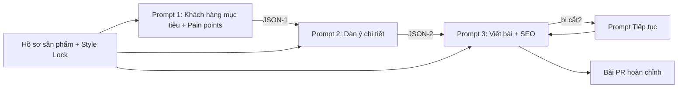

# [Bài thực hành 2] Xây dựng chuỗi Prompt viết bài PR sản phẩm công nghệ

---

## 1. Sơ đồ chuỗi prompt



## 2. Khối dùng chung (dán vào đầu cả 3 prompt)

```text
[HỒ SƠ SẢN PHẨM - KHÔNG ĐƯỢC THAY ĐỔI]
- Tên sản phẩm: [TÊN CHATBOT]
- Loại: giải pháp AI Chatbot dành cho doanh nghiệp
- Tính năng/thông tin đã xác nhận: [liệt kê - chỉ dùng thông tin này]
- Từ khoá SEO chính: "AI Chatbot cho doanh nghiệp"
- Từ khoá phụ: "chatbot chăm sóc khách hàng", "tự động hoá tư vấn", "giải pháp chatbot AI"

[STYLE LOCK - GIỮ NGUYÊN TỪ ĐẦU ĐẾN CUỐI]
- Giọng điệu: chuyên nghiệp, tin cậy, rõ ràng. Ngôi: "chúng tôi"/"doanh nghiệp".
- Không dùng ngôn ngữ giật gân, không cường điệu, không cam kết số liệu chưa được cung cấp.
- Không tự bịa số liệu, tên khách hàng, giải thưởng.
```

## 3. Ba prompt thành phần

### Prompt 1 - Nghiên cứu đối tượng khách hàng & pain points

```text
[Dán HỒ SƠ SẢN PHẨM + STYLE LOCK]

Vai trò: Chuyên gia nghiên cứu thị trường B2B.
Nhiệm vụ: Hãy suy nghĩ từng bước, rồi xác định đối tượng khách hàng mục tiêu của sản phẩm trên và các nỗi đau (pain points) mà sản phẩm giải quyết.
Các bước: (1) liệt kê 2-3 nhóm khách hàng doanh nghiệp phù hợp; (2) với mỗi nhóm nêu vai trò người ra quyết định; (3) liệt kê 5-7 pain points, gắn với tính năng ở Hồ sơ sản phẩm; (4) xếp hạng mức độ cấp bách (Cao/TB/Thấp).
Ràng buộc: chỉ gắn pain point với tính năng đã có trong hồ sơ; điều chưa chắc chắn ghi "[cần xác minh]".
ĐẦU RA BẮT BUỘC - chỉ trả về JSON-1 theo schema, không văn bản thừa:
{
  "target_segments": [{"name": "", "decision_maker": "", "description": ""}],
  "pain_points": [{"id": "PP1", "segment": "", "description": "", "linked_feature": "", "urgency": ""}],
  "key_message_candidates": ["", ""]
}
```

### Prompt 2 - Dàn ý chi tiết (đầu vào bắt buộc: JSON-1)

```text
[Dán HỒ SƠ SẢN PHẨM + STYLE LOCK]

Dữ liệu từ bước trước (BẮT BUỘC sử dụng, không bỏ pain point nào có urgency = "Cao"):
<JSON-1>
[DÁN NGUYÊN VĂN OUTPUT PROMPT 1]
</JSON-1>

Vai trò: Biên tập viên PR công nghệ.
Nhiệm vụ: Hãy suy nghĩ từng bước và lập dàn ý chi tiết cho bài PR 1000-1500 từ, theo cấu trúc chuẩn SEO.
Quy tắc: (1) mỗi pain point "Cao" phải xuất hiện ở ít nhất một mục; (2) Lead phải đề cập pain point cấp bách nhất; (3) có H2/H3 tương ứng; (4) phân bổ số từ mục tiêu cho từng mục, tổng 1000-1500; (5) có CTA cuối bài.
ĐẦU RA BẮT BUỘC - chỉ trả về JSON-2:
{
  "headline_options": ["", "", ""],
  "chosen_headline": "",
  "lead": {"pain_points_used": ["PP1"], "target_words": 0},
  "sections": [{"h2": "", "h3": [""], "pain_points_covered": [], "keywords": [], "target_words": 0}],
  "cta": {"text": "", "target_words": 0},
  "total_target_words": 0
}
```

### Prompt 3 - Viết chi tiết từng phần + tối ưu SEO (đầu vào: JSON-2, JSON-1)

```text
[Dán HỒ SƠ SẢN PHẨM + STYLE LOCK]

Dữ liệu bắt buộc:
<JSON-1>[DÁN]</JSON-1>
<JSON-2>[DÁN NGUYÊN VĂN OUTPUT PROMPT 2]</JSON-2>

Nhiệm vụ: Viết bài PR hoàn chỉnh đúng theo JSON-2, không thêm/bớt/đổi thứ tự mục.
Cấu trúc đầu ra:
1. Headline (H1) = chosen_headline.
2. Lead hấp dẫn, giải quyết pain points đã chỉ định.
3. Các tiêu đề con H2/H3 đúng như dàn ý, viết đủ nội dung cho từng mục.
4. CTA rõ ràng ở cuối bài.
Quy tắc SEO: từ khoá chính xuất hiện trong H1, Lead và ≥ 2 tiêu đề con; từ khoá phụ phân bổ tự nhiên, mật độ từ khoá chính khoảng 1-2%; không nhồi từ khoá; thêm 1 dòng meta description (≤ 160 ký tự) ở cuối.
Quy tắc nhất quán: giữ đúng Style Lock; không đổi cách xưng hô; không lặp ý đã nêu ở mục trước.
Quy tắc đứt quãng: nếu sắp hết độ dài, KẾT THÚC bằng dòng "[[ĐÃ VIẾT ĐẾN: <tên mục H2/H3>]]" thay vì cắt ngang câu.
```

## 4. Quy tắc xử lý khi AI viết bài bị ngắt quãng (max token)

```text
[Prompt Tiếp tục - dán trong cùng hội thoại]

Bài viết bị ngắt. Hãy TIẾP TỤC CHÍNH XÁC từ chỗ dừng.
- Câu cuối cùng đã nhận được: "<DÁN NGUYÊN VĂN 1-2 CÂU CUỐI>"
- Mục đang viết: <tên H2/H3>. Các mục còn lại theo JSON-2: <danh sách>.
Yêu cầu: (1) KHÔNG viết lại, KHÔNG tóm tắt phần trước, KHÔNG thêm lời dẫn như "Tiếp theo…"; (2) bắt đầu bằng đúng từ/câu nối tiếp (nếu câu bị cắt giữa chừng, hoàn thiện câu đó rồi viết tiếp); (3) giữ nguyên Style Lock, ngôi xưng và thuật ngữ; (4) khi xong, in "[[HẾT BÀI]]" rồi liệt kê tổng số từ ước tính.
```

**Quy trình sau khi nối:** ghép các phần, xoá dấu "[[…]]", đọc lại điểm nối (câu cuối phần cũ + câu đầu phần mới) để bảo đảm liền mạch và cùng giọng điệu.

---

## 5. VÍ DỤ CHẠY MẪU

_(Thông tin sản phẩm trong ví dụ là giả lập để minh hoạ; khi dùng thật, thay bằng Hồ sơ sản phẩm chính thức.)_

### Output Prompt 1 (JSON-1 rút gọn)

```json
{
  "target_segments": [
    {
      "name": "Doanh nghiệp thương mại điện tử/bán lẻ",
      "decision_maker": "Giám đốc vận hành, Trưởng CSKH",
      "description": "Lượng tin nhắn khách hàng lớn, lặp lại"
    },
    {
      "name": "Doanh nghiệp dịch vụ (giáo dục, tài chính, y tế tư nhân)",
      "decision_maker": "Giám đốc kinh doanh, CTO",
      "description": "Cần tư vấn nhanh, nhất quán"
    }
  ],
  "pain_points": [
    {
      "id": "PP1",
      "segment": "Bán lẻ",
      "description": "Khách phải chờ lâu ngoài giờ hành chính",
      "linked_feature": "Trả lời tự động 24/7",
      "urgency": "Cao"
    },
    {
      "id": "PP2",
      "segment": "Tất cả",
      "description": "Câu hỏi lặp lại chiếm thời gian nhân viên",
      "linked_feature": "Tự động hoá câu hỏi thường gặp",
      "urgency": "Cao"
    },
    {
      "id": "PP3",
      "segment": "Dịch vụ",
      "description": "Chất lượng tư vấn không đồng đều giữa nhân viên",
      "linked_feature": "Kịch bản tư vấn thống nhất",
      "urgency": "Trung bình"
    }
  ],
  "key_message_candidates": [
    "Tư vấn nhất quán, mọi lúc",
    "Giải phóng đội ngũ khỏi công việc lặp lại"
  ]
}
```

### Output Prompt 2 (JSON-2 rút gọn)

```json
{
  "chosen_headline": "AI Chatbot cho doanh nghiệp: Tư vấn khách hàng nhất quán, mọi lúc mọi nơi",
  "lead": { "pain_points_used": ["PP1", "PP2"], "target_words": 130 },
  "sections": [
    {
      "h2": "Thách thức chăm sóc khách hàng của doanh nghiệp hiện nay",
      "h3": [
        "Chờ đợi ngoài giờ làm việc",
        "Câu hỏi lặp lại làm quá tải đội ngũ"
      ],
      "pain_points_covered": ["PP1", "PP2"],
      "keywords": ["chatbot chăm sóc khách hàng"],
      "target_words": 250
    },
    {
      "h2": "Giải pháp AI Chatbot cho doanh nghiệp hoạt động như thế nào",
      "h3": ["Trả lời tự động 24/7", "Tự động hoá câu hỏi thường gặp"],
      "pain_points_covered": ["PP1", "PP2"],
      "keywords": ["AI Chatbot cho doanh nghiệp", "tự động hoá tư vấn"],
      "target_words": 350
    },
    {
      "h2": "Tư vấn thống nhất, nâng cao trải nghiệm khách hàng",
      "h3": ["Kịch bản nhất quán"],
      "pain_points_covered": ["PP3"],
      "keywords": ["giải pháp chatbot AI"],
      "target_words": 250
    },
    {
      "h2": "Bắt đầu triển khai như thế nào?",
      "h3": [],
      "pain_points_covered": [],
      "keywords": ["AI Chatbot cho doanh nghiệp"],
      "target_words": 150
    }
  ],
  "cta": { "text": "Đăng ký tư vấn và dùng thử giải pháp", "target_words": 70 },
  "total_target_words": 1200
}
```

Kiểm tra: 130 + 250 + 350 + 250 + 150 + 70 = **1200** từ ✔ (trong khoảng 1000-1500).

### Output Prompt 3 (trích đoạn đầu và đoạn bị ngắt → nối tiếp)

> # AI Chatbot cho doanh nghiệp: Tư vấn khách hàng nhất quán, mọi lúc mọi nơi
>
> **Lead:** Một khách hàng nhắn tin lúc 22 giờ và phải chờ đến sáng hôm sau mới có người trả lời; trong khi đó, đội ngũ chăm sóc khách hàng mỗi ngày lại phải gõ đi gõ lại những câu hỏi giống hệt nhau. Đây là hai điểm nghẽn quen thuộc… _(tiếp tục theo dàn ý)_
>
> ## Giải pháp AI Chatbot cho doanh nghiệp hoạt động như thế nào
>
> ### Trả lời tự động 24/7
>
> Giải pháp cho phép doanh nghiệp tiếp nhận và phản hồi yêu cầu của khách hàng ở mọi khung giờ, giúp… _(văn bản bị ngắt tại đây do giới hạn token)_
> `[[ĐÃ VIẾT ĐẾN: H3 "Trả lời tự động 24/7"]]`

**Prompt Tiếp tục được dùng:** câu cuối đã nhận = "…giúp"; mục đang viết = "Trả lời tự động 24/7".

**Đoạn nối tiếp (bắt đầu đúng từ câu bị cắt):**

> …giúp khách hàng nhận được phản hồi ngay cả ngoài giờ hành chính, trong khi đội ngũ nhân sự tập trung vào những yêu cầu cần sự can thiệp của con người. Doanh nghiệp vẫn giữ quyền kiểm soát nội dung trả lời thông qua kịch bản do chính mình thiết lập.

→ Đoạn nối **không lặp lại** phần trước, giữ ngôi "doanh nghiệp", giọng chuyên nghiệp - tin cậy.

### Cấu trúc bài hoàn chỉnh (đạt chuẩn SEO)

| Thành phần                                | Có trong bài                             |
| ----------------------------------------- | ---------------------------------------- |
| Headline (H1) chứa từ khoá chính          | ✔                                        |
| Lead giải quyết pain points PP1, PP2      | ✔                                        |
| H2/H3 khớp dàn ý (4 H2, các H3 tương ứng) | ✔                                        |
| CTA cuối bài                              | ✔ "Đăng ký tư vấn và dùng thử giải pháp" |
| Meta description ≤ 160 ký tự              | ✔                                        |
