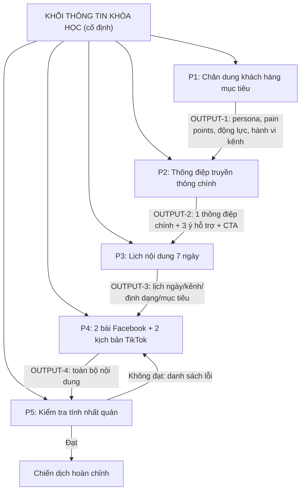

# [Bài thực hành 5] Xây dựng chiến dịch truyền thông tuyển sinh khóa học

---

## 1. Sơ đồ chuỗi prompt



Dạng văn bản: `[Thông tin khóa học] → P1 → P2 → P3 → P4 → P5 → (nếu lệch) quay lại P4 sửa`.

## 2. Khối thông tin khóa học (dán đầu MỌI prompt)

```text
[THÔNG TIN KHÓA HỌC - KHÔNG ĐƯỢC THAY ĐỔI, KHÔNG ĐƯỢC BỔ SUNG SỐ LIỆU MỚI]
- Khóa học: Python cơ bản dành cho người mới bắt đầu
- Đối tượng: sinh viên năm nhất, độ tuổi 18-20
- Thời lượng: 8 tuần
- Mục tiêu chiến dịch: thu hút 100 lượt đăng ký tư vấn
- Kênh truyền thông: Facebook và TikTok
- Thông tin chưa được cung cấp (học phí, ưu đãi, lịch học, giảng viên, link): dùng placeholder [..], TUYỆT ĐỐI không tự bịa.
```

## 3. Năm prompt thành phần

### Prompt 1 - Chân dung khách hàng mục tiêu (bước bắt buộc, không được bỏ qua)

```text
[Dán KHỐI THÔNG TIN KHÓA HỌC]
Vai trò: Chuyên gia nghiên cứu khách hàng giới trẻ.
Nhiệm vụ: Hãy suy nghĩ từng bước và xây dựng chân dung khách hàng mục tiêu cho khóa học.
Bao gồm: (1) hồ sơ nhân khẩu học (không vượt ngoài thông tin đã cho); (2) mục tiêu và động lực; (3) nỗi lo/rào cản khi bắt đầu học lập trình; (4) thói quen dùng Facebook và TikTok; (5) ngôn ngữ, cách nói quen thuộc của nhóm này.
Ghi chú: những điều là giả định ghi "(giả định cần kiểm chứng)".
ĐẦU RA (OUTPUT-1) theo mẫu:
Persona: tên giả định, tuổi, ngành | Mục tiêu | Nỗi đau/rào cản (đánh số P1, P2, P3) | Hành vi trên Facebook | Hành vi trên TikTok | Giọng điệu phù hợp
```

### Prompt 2 - Thông điệp truyền thông (đầu vào: OUTPUT-1)

```text
[Dán KHỐI THÔNG TIN KHÓA HỌC]
Đầu vào bắt buộc: <OUTPUT-1> [dán nguyên văn kết quả Prompt 1] </OUTPUT-1>
Nhiệm vụ: Xác định MỘT thông điệp truyền thông chính duy nhất, phù hợp chân dung ở OUTPUT-1.
Yêu cầu: (1) thông điệp chính ≤ 20 từ, giải quyết ít nhất 2 nỗi đau đã nêu (chỉ rõ P-số nào); (2) 3 ý hỗ trợ, mỗi ý chỉ dùng thông tin khóa học đã cho; (3) lời kêu gọi hành động (CTA) = đăng ký tư vấn; (4) giọng điệu thống nhất cho cả 2 kênh; (5) 3 điều KHÔNG được nói (ví dụ: cam kết kết quả/việc làm chưa có căn cứ).
ĐẦU RA (OUTPUT-2): Thông điệp chính | Nỗi đau giải quyết | 3 ý hỗ trợ | CTA | Giọng điệu | Điều không nói
```

### Prompt 3 - Kế hoạch nội dung 7 ngày (đầu vào: OUTPUT-1 + OUTPUT-2)

```text
[Dán KHỐI THÔNG TIN KHÓA HỌC]
Đầu vào bắt buộc: <OUTPUT-1>[…]</OUTPUT-1> <OUTPUT-2>[…]</OUTPUT-2>
Nhiệm vụ: Lập lịch nội dung 7 ngày (Ngày 1-7) cho Facebook và TikTok nhằm thu hút 100 lượt đăng ký tư vấn.
Quy tắc: (1) mỗi mục lịch ghi: Ngày | Kênh | Định dạng | Chủ đề | Nỗi đau/ý hỗ trợ được dùng (trích từ OUTPUT-1/2) | CTA; (2) bắt buộc có đúng 2 bài Facebook và 2 video TikTok là nội dung chính, các ngày còn lại là nội dung hỗ trợ/tương tác; (3) tiến trình: nhận diện vấn đề → giới thiệu giải pháp → thúc đẩy đăng ký; (4) mọi mục phải bám thông điệp chính ở OUTPUT-2.
ĐẦU RA (OUTPUT-3): bảng lịch 7 ngày.
```

### Prompt 4 - Viết bài Facebook & kịch bản TikTok (đầu vào: OUTPUT-1, 2, 3)

```text
[Dán KHỐI THÔNG TIN KHÓA HỌC]
Đầu vào bắt buộc: <OUTPUT-1>[…]</OUTPUT-1> <OUTPUT-2>[…]</OUTPUT-2> <OUTPUT-3>[…]</OUTPUT-3>
Nhiệm vụ: Viết (a) 2 bài đăng Facebook và (b) 2 kịch bản video TikTok 30-45 giây, đúng vị trí đã xếp trong lịch OUTPUT-3.
Quy tắc: (1) mỗi nội dung nhắc lại thông điệp chính theo cách khác nhau, không lặp nguyên văn; (2) Facebook: tiêu đề/hook, thân bài, CTA, hashtag; (3) TikTok: hook 3 giây đầu, bảng kịch bản theo mốc thời gian (Thời gian | Hình ảnh | Lời thoại/Chữ trên màn hình), tổng 30-45 giây (lời thoại khoảng 80-120 từ), CTA cuối video; (4) chỉ dùng thông tin khóa học đã cho; chỗ chưa có dùng [..]; (5) cùng giọng điệu ở OUTPUT-2.
ĐẦU RA (OUTPUT-4): 2 bài Facebook + 2 kịch bản TikTok.
```

### Prompt 5 - Kiểm tra tính thống nhất (đầu vào: tất cả output)

```text
[Dán KHỐI THÔNG TIN KHÓA HỌC]
Đầu vào: <OUTPUT-1>…</OUTPUT-1> <OUTPUT-2>…</OUTPUT-2> <OUTPUT-3>…</OUTPUT-3> <OUTPUT-4>…</OUTPUT-4>
Nhiệm vụ: Hãy suy nghĩ từng bước và kiểm tra tính nhất quán của chiến dịch với danh sách sau; mỗi mục ghi Đạt/Không đạt + bằng chứng trích từ nội dung (không nhận xét chung chung):
1. Thông tin khóa học (đối tượng, 8 tuần, Python cơ bản, kênh, mục tiêu 100) khớp với khối thông tin gốc, không bị thay đổi/bịa thêm.
2. Mọi nội dung bám đúng chân dung (OUTPUT-1) và giải quyết nỗi đau đã chọn.
3. Thông điệp chính (OUTPUT-2) xuất hiện trong cả 4 nội dung.
4. Lịch (OUTPUT-3) và nội dung (OUTPUT-4) khớp nhau (ngày, kênh, định dạng).
5. Giọng điệu và CTA thống nhất giữa Facebook và TikTok.
6. Kịch bản TikTok dài 30-45 giây.
Cuối cùng: kết luận chung + danh sách chỉnh sửa cần làm (nếu có).
ĐẦU RA (OUTPUT-5): Báo cáo kiểm tra nhất quán.
```

---

## 4. KẾT QUẢ CHẠY MẪU CHIẾN DỊCH

_(Phần nội dung giả lập cho mục đích minh hoạ; mọi thông tin chưa được cung cấp dùng placeholder.)_

### 4.1 Chân dung khách hàng mục tiêu (OUTPUT-1)

| Mục                     | Nội dung                                                                                                                                                                     |
| ----------------------- | ---------------------------------------------------------------------------------------------------------------------------------------------------------------------------- |
| **Persona**             | **Minh**, 18 tuổi, sinh viên năm nhất (giả định ngành thuộc khối kỹ thuật/kinh tế), chưa từng viết code                                                                      |
| **Mục tiêu & động lực** | Muốn có kỹ năng công nghệ hữu ích cho học tập và tương lai; muốn bắt kịp bạn bè; tò mò về lập trình                                                                          |
| **Nỗi đau/rào cản**     | **P1:** Sợ lập trình khó, "không hợp với mình"; **P2:** Không biết bắt đầu từ đâu giữa quá nhiều nguồn tự học; **P3:** Lo không theo kịp nếu học quá nhanh hoặc học một mình |
| **Facebook**            | Theo dõi group sinh viên, fanpage trường/CLB; đọc bài có ví dụ gần gũi, thích bài ngắn rõ ràng                                                                               |
| **TikTok**              | Xem video ngắn giải trí - kiến thức; thích mở đầu bắt mắt trong vài giây, ngôn ngữ đời thường                                                                                |
| **Giọng điệu**          | Thân thiện, gần gũi, khích lệ, không "dạy đời", không thuật ngữ khó                                                                                                          |

### 4.2 Thông điệp truyền thông chính (OUTPUT-2)

> **"Chưa biết gì về lập trình? 8 tuần để bắt đầu Python từ con số 0."** (≤ 20 từ)

- **Nỗi đau giải quyết:** P1, P2, P3.
- **3 ý hỗ trợ (chỉ dùng thông tin đã cho):** (1) Khóa Python cơ bản dành riêng cho người mới bắt đầu; (2) Lộ trình rõ ràng 8 tuần; (3) Phù hợp sinh viên năm nhất.
- **CTA:** "Đăng ký tư vấn ngay: [link/số điện thoại]".
- **Điều không nói:** cam kết việc làm/thu nhập; so sánh hạ thấp khóa học khác; học phí, ưu đãi khi chưa có thông tin.

### 4.3 Lịch đăng nội dung 7 ngày (OUTPUT-3)

| Ngày | Kênh              | Định dạng                | Chủ đề                                                                                | Nỗi đau/ý hỗ trợ | CTA                         |
| ---- | ----------------- | ------------------------ | ------------------------------------------------------------------------------------- | ---------------- | --------------------------- |
| 1    | Facebook          | **Bài đăng 1** (chính)   | "Lập trình có thật sự khó?" - nhận diện nỗi lo của sinh viên năm nhất                 | P1               | Đăng ký tư vấn              |
| 2    | TikTok            | **Video 1** (chính)      | "3 điều sinh viên năm nhất hay lo khi học code"                                       | P1, P2           | Đăng ký tư vấn (link ở bio) |
| 3    | Facebook          | Ảnh/infographic          | Giới thiệu khóa: Python cơ bản - 8 tuần - dành cho người mới (chỉ dùng thông tin gốc) | Ý hỗ trợ 1, 2    | Đăng ký tư vấn              |
| 4    | TikTok            | **Video 2** (chính)      | "Bắt đầu Python từ con số 0 - vì sao 8 tuần?"                                         | P2, P3           | Đăng ký tư vấn              |
| 5    | Facebook          | **Bài đăng 2** (chính)   | Giải đáp: "Mình chưa biết gì có học được không?"                                      | P1, P3           | Đăng ký tư vấn              |
| 6    | Facebook + TikTok | Tương tác                | Trả lời bình luận/tin nhắn, chia sẻ câu hỏi thường gặp                                | P1-P3            | Đăng ký tư vấn              |
| 7    | Facebook + TikTok | Nhắc nhở chốt chiến dịch | Tổng kết thông điệp chính, nhắc đăng ký tư vấn                                        | Thông điệp chính | Đăng ký tư vấn ngay         |

### 4.4 Hai bài đăng Facebook (OUTPUT-4a)

**Bài Facebook 1 (Ngày 1)**

> **Lập trình khó? Có thể chỉ là chưa ai chỉ cho bạn bước đầu tiên 👀**
>
> Bạn vừa lên năm nhất và nghe quanh mình toàn "lập trình khó lắm", "phải giỏi toán mới học được"? Nhiều bạn mới bắt đầu cũng đang lo đúng như vậy.
>
> Khóa **Python cơ bản dành cho người mới bắt đầu** sẽ đồng hành cùng bạn trong **8 tuần** để làm quen với lập trình từ con số 0.
>
> ✅ Dành cho sinh viên năm nhất, chưa cần biết gì về lập trình
> ✅ Lộ trình rõ ràng trong 8 tuần
>
> 👉 **Đăng ký tư vấn ngay:** [link/số điện thoại]
>
> #Python #HocLapTrinh #SinhVienNamNhat

**Bài Facebook 2 (Ngày 5)**

> **"Mình chưa biết gì thì học Python được không?" - Câu trả lời cho bạn 💬**
>
> Đây là câu hỏi các bạn năm nhất hỏi nhiều nhất. Khóa **Python cơ bản** được thiết kế cho **người mới bắt đầu**: bạn không cần có nền tảng lập trình trước đó, và có lộ trình **8 tuần** để từng bước làm quen.
>
> Bạn lo học một mình sẽ bí? Hãy để chúng mình tư vấn xem khóa học có phù hợp với bạn không.
>
> 👉 **Đăng ký tư vấn:** [link/số điện thoại]
>
> #Python #HocLapTrinh #SinhVienNamNhat

### 4.5 Hai kịch bản video TikTok (OUTPUT-4b)

**Kịch bản TikTok 1 - "3 điều sinh viên năm nhất hay lo khi học code" (≈ 40 giây)**

| Thời gian    | Hình ảnh                                          | Lời thoại / Chữ trên màn hình                                                                        |
| ------------ | ------------------------------------------------- | ---------------------------------------------------------------------------------------------------- |
| 0-3s (HOOK)  | Bạn nam mặt cau có nhìn laptop                    | "Lập trình khó lắm đúng không? 🤯"                                                                   |
| 3-12s        | Chữ "Nỗi lo 1" hiện lên, bạn gãi đầu              | "Nỗi lo số một: sợ mình không hợp với lập trình. Nhiều bạn năm nhất chưa biết gì cũng nghĩ như vậy." |
| 12-22s       | "Nỗi lo 2", cuộn nhiều tab trên màn hình          | "Nỗi lo số hai: không biết bắt đầu từ đâu giữa hàng tá nguồn học."                                   |
| 22-31s       | "Nỗi lo 3", bạn ngồi một mình                     | "Nỗi lo số ba: sợ học một mình rồi bỏ cuộc giữa chừng."                                              |
| 31-40s (CTA) | Chữ lớn: "Python cơ bản - 8 tuần - cho người mới" | "Khóa Python cơ bản cho người mới, 8 tuần để bắt đầu từ con số 0. Đăng ký tư vấn, link ở bio!"       |

Lời thoại ≈ 90 từ, nhịp nói bình thường → khoảng 38-42 giây ✔.

**Kịch bản TikTok 2 - "Bắt đầu Python từ con số 0 - vì sao 8 tuần?" (≈ 35 giây)**

| Thời gian    | Hình ảnh                                        | Lời thoại / Chữ trên màn hình                                                                         |
| ------------ | ----------------------------------------------- | ----------------------------------------------------------------------------------------------------- |
| 0-3s (HOOK)  | Đồng hồ đếm "8 tuần"                            | "8 tuần - đủ để bạn bắt đầu lập trình chưa?"                                                          |
| 3-15s        | Bạn nữ gõ dòng code đầu tiên, chữ "Từ con số 0" | "Với người chưa biết gì, khóa Python cơ bản đi từng bước nhỏ, bắt đầu từ những khái niệm nền tảng."   |
| 15-27s       | Biểu tượng lộ trình 8 tuần                      | "Lộ trình 8 tuần rõ ràng giúp bạn biết mình đang ở đâu và cần làm gì tiếp theo, không còn loay hoay." |
| 27-35s (CTA) | Màn hình kết: link đăng ký                      | "Là sinh viên năm nhất muốn bắt đầu? Đăng ký tư vấn ngay, link ở bio nhé!"                            |

Lời thoại ≈ 80 từ → khoảng 33-37 giây ✔.

### 4.6 Báo cáo kiểm tra tính nhất quán (OUTPUT-5)

| #   | Hạng mục kiểm tra                              | Kết quả | Bằng chứng                                                                                                     |
| --- | ---------------------------------------------- | ------- | -------------------------------------------------------------------------------------------------------------- |
| 1   | Thông tin khóa học không bị thay đổi/bịa thêm  | **Đạt** | Mọi nội dung chỉ nêu: Python cơ bản, người mới, 8 tuần, sinh viên năm nhất; không có học phí/ưu đãi/giảng viên |
| 2   | Bám chân dung và nỗi đau                       | **Đạt** | Bài FB1, TikTok1 → P1, P2, P3; FB2 → P1, P3; TikTok2 → P2, P3                                                  |
| 3   | Thông điệp chính xuất hiện trong cả 4 nội dung | **Đạt** | Cụm "bắt đầu từ con số 0 / 8 tuần / người mới" có trong FB1, FB2, TikTok1, TikTok2                             |
| 4   | Lịch và nội dung khớp                          | **Đạt** | FB1 = Ngày 1; TikTok1 = Ngày 2; TikTok2 = Ngày 4; FB2 = Ngày 5                                                 |
| 5   | Giọng điệu & CTA thống nhất                    | **Đạt** | Thân thiện; CTA "Đăng ký tư vấn" ở mọi nội dung                                                                |
| 6   | Độ dài TikTok 30-45s                           | **Đạt** | ≈ 40s và ≈ 35s                                                                                                 |

**Kết luận:** Chiến dịch nhất quán từ khách hàng mục tiêu → thông điệp → lịch → nội dung. **Lưu ý trước khi đăng:** điền các placeholder `[link/số điện thoại]`; nếu có học phí/ưu đãi/lịch học chính thức, bổ sung vào các bài sau khi trung tâm xác nhận. Mục tiêu 100 lượt đăng ký nên được theo dõi theo từng kênh trong 7 ngày.
