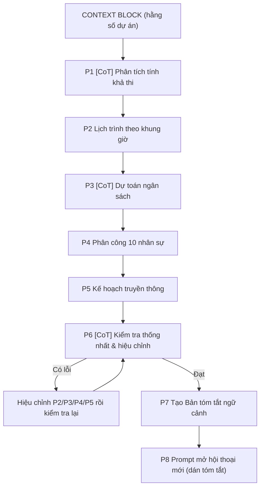

# [Bài thực hành 7] Xây dựng kế hoạch tổ chức sự kiện công nghệ AI Innovation Day

---

## 1. Sơ đồ chuỗi prompt



## 2. BỘ PROMPT HOÀN CHỈNH

### Khối dùng chung: CONTEXT BLOCK (dán đầu mọi prompt)

```text
[CONTEXT BLOCK – HẰNG SỐ DỰ ÁN, KHÔNG ĐƯỢC THAY ĐỔI]
- Sự kiện: "AI Innovation Day" dành cho sinh viên trong trường, tổ chức 1 ngày.
- Quy mô: 150 sinh viên (KHÔNG đổi).
- Nhân sự tổ chức: 10 người (KHÔNG đổi).
- Ngân sách tối đa: 15.000.000 đồng (KHÔNG vượt; tổng chi + dự phòng ≤ 15.000.000).
- Mục tiêu: giúp sinh viên hiểu và trải nghiệm ứng dụng AI trong học tập và công việc.
- Quy tắc chung: chỉ dùng số liệu đã cho hoặc ghi rõ là "giả định"; mọi hạng mục phải liên kết (chương trình ↔ ngân sách ↔ nhân sự ↔ truyền thông); số liệu chuyển giữa các bước phải giữ nguyên.
[TRẠNG THÁI CHUỖI]: Bước hiện tại = <n>; các bước đã hoàn thành = <danh sách>.
```

### P1 – Phân tích tính khả thi (Chain-of-Thought)

```text
[Dán CONTEXT BLOCK]
Hãy suy nghĩ từng bước một để phân tích tính khả thi của sự kiện, theo trình tự:
Bước 1: Quy mô – địa điểm: 150 sinh viên cần không gian/thiết bị gì? Liệt kê điều kiện tối thiểu.
Bước 2: Nhân sự: tỷ lệ nhân sự/sinh viên (10 người : 150 SV); chia theo nhóm việc có đủ không?
Bước 3: Thời gian: 1 ngày chứa được những khối nội dung nào để đạt mục tiêu (hiểu + trải nghiệm)?
Bước 4: Ngân sách sơ bộ: ngân sách bình quân/sinh viên = 15.000.000 ÷ 150 = ?; so sánh với các khoản chi bắt buộc.
Bước 5: Rủi ro: liệt kê ≥ 5 rủi ro (xác suất, tác động, biện pháp giảm thiểu).
Bước 6: Kết luận khả thi (Khả thi / Khả thi có điều kiện / Không khả thi) + điều kiện.
Hiển thị đầy đủ phép tính. Chỉ ghi giả định khi buộc phải dùng và gắn nhãn "GIẢ ĐỊNH".
Đầu ra (OUT-1): Bản phân tích khả thi + bảng giả định + bảng rủi ro.
```

### P2 – Lịch trình (đầu vào OUT-1)

```text
[Dán CONTEXT BLOCK] + <OUT-1>[dán]</OUT-1>
Xây dựng lịch trình chương trình trong 1 ngày theo khung giờ. Yêu cầu: (1) đảm bảo mục tiêu "hiểu" (phiên chia sẻ) và "trải nghiệm" (workshop/thực hành); (2) mỗi khung giờ ghi: thời gian, hoạt động, người phụ trách (vai trò), nhu cầu vật chất; (3) có giờ nghỉ, tea-break, nghỉ trưa; (4) tuân thủ điều kiện/giả định ở OUT-1.
Đầu ra (OUT-2): Bảng lịch trình + danh sách nhu cầu vật chất phát sinh (để P3 dự toán).
```

### P3 – Dự toán ngân sách (CoT, đầu vào OUT-1, OUT-2)

```text
[Dán CONTEXT BLOCK] + <OUT-1>…</OUT-1> <OUT-2>…</OUT-2>
Hãy suy nghĩ từng bước để lập dự toán:
Bước 1: Mỗi nhu cầu vật chất ở OUT-2 → một hạng mục chi, ghi đơn giá × số lượng = thành tiền.
Bước 2: Cộng từng hạng mục, hiển thị phép cộng.
Bước 3: So với 15.000.000: nếu vượt, nêu số vượt và điều chỉnh (giảm hạng mục nào, vì sao) rồi tính lại.
Bước 4: Trích quỹ dự phòng 5–8% ngân sách; kiểm tra tổng chi + dự phòng ≤ 15.000.000.
Bước 5: Tính tỷ lệ % mỗi hạng mục.
Đầu ra (OUT-3): Bảng dự toán (STT | Hạng mục | Cách tính | Thành tiền | % | Gắn với hoạt động nào ở lịch trình) + tổng kiểm tra. Nếu có điều chỉnh thì báo cáo phần thay đổi để P2 cập nhật.
```

### P4 – Phân công 10 nhân sự (đầu vào OUT-2, OUT-3)

```text
[Dán CONTEXT BLOCK] + <OUT-2>…</OUT-2> <OUT-3>…</OUT-3>
Phân công đúng 10 nhân sự (không thêm/bớt). Mỗi người: mã (NS01–NS10), vai trò, nhiệm vụ trước – trong – sau sự kiện, khung giờ làm việc chính, liên hệ hạng mục ngân sách mà người đó phụ trách. Đảm bảo không khung giờ nào ở OUT-2 thiếu người phụ trách và không ai bị quá tải (hai nhiệm vụ trọng yếu cùng lúc).
Đầu ra (OUT-4): Bảng phân công + ma trận (khung giờ × nhân sự).
```

### P5 – Kế hoạch truyền thông (đầu vào OUT-2, OUT-3, OUT-4)

```text
[Dán CONTEXT BLOCK] + <OUT-2>…</OUT-2> <OUT-3>…</OUT-3> <OUT-4>…</OUT-4>
Lập kế hoạch truyền thông TRƯỚC sự kiện: mục tiêu (đủ 150 sinh viên tham dự), kênh, các giai đoạn theo mốc "T-n ngày", nội dung từng giai đoạn, người phụ trách (theo OUT-4), chi phí (khớp hạng mục truyền thông ở OUT-3), cách đăng ký/giữ chỗ (không vượt 150 chỗ chính thức), chỉ số theo dõi.
Đầu ra (OUT-5): Kế hoạch truyền thông dạng bảng theo mốc thời gian.
```

### P6 – Kiểm tra thống nhất & hiệu chỉnh (CoT)

```text
[Dán CONTEXT BLOCK] + <OUT-1>…</OUT-1> … <OUT-5>…</OUT-5>
Hãy suy nghĩ từng bước, đóng vai kiểm toán viên độc lập:
Bước 1: Đối chiếu hằng số: 150 SV, 10 nhân sự, 1 ngày, ≤ 15.000.000 có bị thay đổi ở bất kỳ OUT nào không?
Bước 2: Cộng lại toàn bộ ngân sách ở OUT-3 (hiển thị phép cộng).
Bước 3: Chương trình ↔ ngân sách: mỗi hoạt động có chi phí tương ứng? mỗi hạng mục chi có hoạt động tương ứng?
Bước 4: Chương trình ↔ nhân sự: mọi khung giờ có người phụ trách? số nhân sự = 10?
Bước 5: Truyền thông ↔ ngân sách/nhân sự: chi phí và người phụ trách khớp?
Bước 6: Rủi ro còn lại (so với OUT-1).
Đầu ra (OUT-6): Bảng phát hiện (Mã lỗi | Mô tả | Mức độ | Hạng mục liên quan | Cách hiệu chỉnh) + phiên bản đã hiệu chỉnh của các phần bị ảnh hưởng + kết luận "ĐẠT/KHÔNG ĐẠT". Nếu KHÔNG ĐẠT, lặp lại kiểm tra sau khi hiệu chỉnh.
```

### P7 – Tạo Bản tóm tắt ngữ cảnh (Context Management)

```text
Hãy tạo BẢN TÓM TẮT NGỮ CẢNH DỰ ÁN để tôi dán vào hội thoại mới và tiếp tục hoàn thiện kế hoạch mà không mất thông tin.
Yêu cầu: ≤ 400 từ; giữ NGUYÊN VĂN các con số quan trọng (hằng số, từng hạng mục ngân sách, khung giờ, vai trò nhân sự); chia mục: (1) Hằng số dự án; (2) Quyết định đã chốt; (3) Số liệu chính; (4) Vấn đề đã phát hiện & đã sửa; (5) Việc còn lại/mở; (6) Quy tắc làm việc cho AI. Không thêm thông tin mới, không diễn giải lại số liệu.
```

### P8 – Prompt khởi động hội thoại mới

```text
Bạn đang tiếp tục một dự án đang dở. Dưới đây là BẢN TÓM TẮT NGỮ CẢNH, hãy coi là dữ liệu chuẩn:
<CONTEXT_SUMMARY>[dán bản tóm tắt]</CONTEXT_SUMMARY>
Nhiệm vụ: (1) Nhắc lại ngắn gọn 6 hằng số/quyết định quan trọng để tôi xác nhận bạn đã hiểu; (2) Nếu thấy mâu thuẫn hoặc thiếu thông tin, hỏi trước khi làm; (3) Sau khi tôi xác nhận, tiếp tục "Việc còn lại" mà không thay đổi quy mô, nhân sự, ngân sách tối đa và các quyết định đã chốt.
```

---

## 3. KẾT QUẢ CHẠY MẪU

_(Các số liệu ngoài 5 hằng số của đề, như đơn giá hay địa điểm, là **giả định** để minh hoạ và có thể thay bằng báo giá thực tế.)_

### 4.1 Bản phân tích tính khả thi (OUT-1)

| Bước                 | Phân tích                                                                                                                                       | Kết quả                                                                   |
| -------------------- | ----------------------------------------------------------------------------------------------------------------------------------------------- | ------------------------------------------------------------------------- |
| 1. Quy mô – địa điểm | 150 sinh viên + 10 BTC + 2 diễn giả ≈ 162 người → cần hội trường ≥ 170 chỗ ngồi, hệ thống âm thanh, màn chiếu, Wi-Fi ổn định cho phần thực hành | **Điều kiện:** dùng hội trường của trường (giả định)                      |
| 2. Nhân sự           | 150 ÷ 10 = **15 sinh viên/nhân sự**; chia 6 nhóm việc                                                                                           | Đủ nếu phân công rõ                                                       |
| 3. Thời gian         | 1 ngày (≈ 8 giờ chương trình) chứa: khai mạc, 2 phiên chia sẻ, 1 workshop, 1 thử thách thực hành, trao giải                                     | Đủ đạt "hiểu" + "trải nghiệm"                                             |
| 4. Ngân sách sơ bộ   | 15.000.000 ÷ 150 = **100.000 đồng/sinh viên**                                                                                                   | Đủ cho sự kiện 1 ngày nếu dùng địa điểm trường, sinh viên tự túc bữa trưa |
| 5. Rủi ro            | R1 Wi-Fi/thiết bị cho phần thực hành; R2 diễn giả vắng/trễ; R3 sinh viên đăng ký nhưng không đến; R4 vượt ngân sách; R5 trễ lịch trình          | Biện pháp trong bảng dưới                                                 |
| 6. Kết luận          | **KHẢ THI CÓ ĐIỀU KIỆN**                                                                                                                        | Điều kiện: có hội trường, Wi-Fi, sinh viên tự mang thiết bị               |

**Giả định:** (G1) hội trường của trường, chỉ tính phí vận hành; (G2) sinh viên tự túc bữa trưa và mang thiết bị cá nhân; (G3) 2 diễn giả khách mời.

| Rủi ro            | Mức        | Biện pháp giảm thiểu                                                                                                     |
| ----------------- | ---------- | ------------------------------------------------------------------------------------------------------------------------ |
| R1 Wi-Fi/thiết bị | Cao        | Kiểm tra mạng trước 1 ngày; hướng dẫn sinh viên chuẩn bị tài khoản; có kịch bản không cần mạng (phần demo trên màn hình) |
| R2 Diễn giả vắng  | Trung bình | Xác nhận trước 3 ngày; chuẩn bị phương án người dẫn dự phòng trong CLB                                                   |
| R3 Vắng mặt       | Trung bình | Nhận đăng ký 170 và giữ danh sách chờ; quy mô chính thức vẫn **150**                                                     |
| R4 Vượt ngân sách | Cao        | Quỹ dự phòng 7,47%; mọi chi phát sinh phải qua phụ trách tài chính                                                       |
| R5 Trễ lịch       | Trung bình | Có người bấm giờ; mỗi phiên có thời gian đệm                                                                             |

### 3.2 Lịch trình sự kiện theo khung giờ (OUT-2, đã hiệu chỉnh)

| Khung giờ     | Hoạt động                                                                     | Phụ trách             | Vật chất            |
| ------------- | ----------------------------------------------------------------------------- | --------------------- | ------------------- |
| 07:30 – 08:15 | Check-in, nhận thẻ tên                                                        | Đón tiếp (NS07, NS08) | Thẻ tên, danh sách  |
| 08:15 – 08:30 | Khai mạc, giới thiệu chương trình                                             | MC (NS02)             | Âm thanh, backdrop  |
| 08:30 – 09:30 | **Phiên 1:** AI trong học tập (diễn giả 1)                                    | NS03                  | Màn hình, mic       |
| 09:30 – 09:50 | Tea-break                                                                     | Hậu cần (NS05, NS06)  | Tea-break, nước     |
| 09:50 – 11:30 | **Workshop:** thực hành prompting với AI cho học tập (do CLB hướng dẫn)       | NS03, NS04            | Wi-Fi, tài liệu in  |
| 11:30 – 13:15 | Nghỉ trưa (sinh viên tự túc)                                                  | –                     | –                   |
| 13:15 – 14:15 | **Phiên 2:** AI trong công việc và nghề nghiệp (diễn giả 2)                   | NS03                  | Màn hình, mic       |
| 14:15 – 15:15 | **Thử thách thực hành:** nhóm 5 sinh viên (30 nhóm) giải bài toán nhỏ bằng AI | NS03, NS04, NS05      | Giấy A0, bút, Wi-Fi |
| 15:15 – 15:50 | Trình bày 6 nhóm xuất sắc (mỗi nhóm 5 phút)                                   | MC (NS02)             | Mic, màn hình       |
| 15:50 – 16:15 | Trao giải, mini game                                                          | NS02, NS04            | Quà/giải thưởng     |
| 16:15 – 16:30 | Bế mạc, khảo sát phản hồi                                                     | NS10, NS01            | Biểu mẫu, mã QR     |
| 16:30 – 17:00 | Dọn dẹp, tổng kết nhanh BTC                                                   | Toàn BTC              | –                   |

Kiểm tra: 30 nhóm × 5 = 150 sinh viên ✔; 6 nhóm × 5 phút = 30 phút (nằm trong khung 35 phút) ✔.

### 3.3 Bảng dự toán ngân sách (OUT-3)

| STT | Hạng mục                                                         | Cách tính               | Thành tiền (đ) |                 % |
| --: | ---------------------------------------------------------------- | ----------------------- | -------------: | ----------------: |
|   1 | Địa điểm: phí vận hành hội trường (điện, vệ sinh, bảo vệ)        | Trọn gói                |      1.500.000 |             10,00 |
|   2 | Âm thanh – ánh sáng – màn hình                                   | Trọn gói                |      2.000.000 |             13,33 |
|   3 | Backdrop, banner, standee                                        | Trọn gói                |      1.000.000 |              6,67 |
|   4 | In ấn (thẻ tên, tài liệu, phiếu)                                 | Trọn gói                |        800.000 |              5,33 |
|   5 | Diễn giả (2 người × 1.000.000, gồm quà cảm ơn)                   | 2 × 1.000.000           |      2.000.000 |             13,33 |
|   6 | Tea-break                                                        | 160 suất × 22.000       |      3.520.000 |             23,47 |
|   7 | Nước uống                                                        | 160 × 6.000             |        960.000 |              6,40 |
|   8 | Giải thưởng thử thách và mini game                               | Trọn gói                |        800.000 |              5,33 |
|   9 | Truyền thông (in poster 400.000 + quảng cáo mạng xã hội 400.000) | 400.000 + 400.000       |        800.000 |              5,33 |
|  10 | Hậu cần, văn phòng phẩm                                          | Trọn gói                |        500.000 |              3,33 |
|     | **Tổng chi cố định**                                             |                         | **13.880.000** |             92,53 |
|  11 | **Quỹ dự phòng**                                                 | 15.000.000 − 13.880.000 |  **1.120.000** |              7,47 |
|     | **TỔNG CỘNG**                                                    |                         | **15.000.000** | 100,00 (làm tròn) |

**Phép cộng kiểm tra:** 1.500.000 + 2.000.000 + 1.000.000 + 800.000 + 2.000.000 + 3.520.000 + 960.000 + 800.000 + 800.000 + 500.000 = **13.880.000**; 13.880.000 + 1.120.000 = **15.000.000** ≤ 15.000.000 ✔. Chi phí/sinh viên (chi cố định) = 13.880.000 ÷ 150 ≈ 92.533 đ.
_(160 suất = 150 sinh viên + 10 nhân sự; diễn giả được tiếp đón trong hạng mục 5.)_

### 3.4 Bảng phân công 10 nhân sự (OUT-4)

| Mã   | Vai trò                        | Nhiệm vụ chính                                                          | Ngân sách liên quan |
| ---- | ------------------------------ | ----------------------------------------------------------------------- | ------------------- |
| NS01 | Trưởng ban tổ chức             | Điều phối chung, làm việc với nhà trường, xử lý sự cố, bế mạc           | Duyệt chi           |
| NS02 | MC & điều phối chương trình    | Dẫn chương trình, bấm giờ, mini game, trao giải                         | Hạng mục 8          |
| NS03 | Phụ trách nội dung & diễn giả  | Liên hệ/xác nhận 2 diễn giả, chuẩn bị tài liệu, điều phối phiên chia sẻ | Hạng mục 5          |
| NS04 | Phụ trách workshop & thử thách | Hướng dẫn workshop, chia nhóm, chấm thử thách                           | Hạng mục 4, 8       |
| NS05 | Hậu cần – địa điểm             | Bố trí hội trường, vật tư, hỗ trợ thử thách                             | Hạng mục 1, 10      |
| NS06 | Hậu cần – tea-break & nước     | Đặt và phục vụ tea-break, nước uống                                     | Hạng mục 6, 7       |
| NS07 | Đón tiếp – check-in            | Check-in, phát thẻ tên, hướng dẫn chỗ ngồi                              | Hạng mục 4          |
| NS08 | Đón tiếp – danh sách chờ       | Xử lý danh sách chờ, hỗ trợ sinh viên, hỗ trợ kỹ thuật Wi-Fi            | –                   |
| NS09 | Truyền thông                   | Poster, mạng xã hội, ảnh/video sự kiện                                  | Hạng mục 3, 9       |
| NS10 | Tài chính – thư ký             | Theo dõi thu chi, quỹ dự phòng, khảo sát phản hồi, biên bản             | Hạng mục 11         |

Kiểm tra: số nhân sự = **10** ✔; mọi khung giờ ở mục 4.2 đều có người phụ trách ✔. _(Ngoài NS09, truyền thông trước sự kiện có thêm NS08 hỗ trợ đăng bài khi cần; vẫn trong 10 người.)_

### 3.5 Kế hoạch truyền thông trước sự kiện (OUT-5)

**Mục tiêu:** đủ **150** sinh viên tham dự (nhận đăng ký 170 + danh sách chờ, quy mô chính thức không đổi). **Kênh:** Facebook CLB/khoa, TikTok, nhóm Zalo lớp, poster tại trường. **Ngân sách:** 800.000 đ (khớp hạng mục 9). **Phụ trách:** NS09 (chính), NS08 (hỗ trợ).

| Mốc         | Giai đoạn    | Nội dung                                                                            | Kênh                               |
| ----------- | ------------ | ----------------------------------------------------------------------------------- | ---------------------------------- |
| T-21 → T-15 | Gợi mở       | Teaser "AI Innovation Day sắp diễn ra", câu hỏi tương tác về AI trong học tập       | Facebook, TikTok                   |
| T-14 → T-4  | Mở đăng ký   | Công bố chương trình, diễn giả, workshop; link đăng ký; dán poster                  | Facebook, TikTok, Zalo lớp, poster |
| T-10        | Đẩy mạnh     | Quảng cáo trả phí nhỏ (≈ 400.000 đ), bài giới thiệu thử thách thực hành             | Facebook                           |
| T-3 → T-1   | Nhắc lịch    | Gửi thông tin giờ, địa điểm, chuẩn bị thiết bị, nhắc giờ check-in; xác nhận tham dự | Zalo lớp, email                    |
| T-0         | Ngày sự kiện | Đăng ảnh/clip trực tiếp, hashtag sự kiện                                            | Facebook, TikTok                   |

**Chỉ số theo dõi:** số đăng ký (mục tiêu 170), tỷ lệ xác nhận tham dự trước ngày sự kiện, số người đến thực tế (mục tiêu 150).

### 3.6 Báo cáo kiểm tra và hiệu chỉnh kế hoạch (OUT-6)

**Phiên bản nháp v1 (trước hiệu chỉnh):** 3 diễn giả × 1.000.000 = 3.000.000; tea-break 160 × 30.000 = 4.800.000; backdrop 1.200.000; giải thưởng 1.000.000; các hạng mục khác như mục 3.3. Tổng v1 = 1.500.000 + 2.000.000 + 1.200.000 + 800.000 + 3.000.000 + 4.800.000 + 960.000 + 1.000.000 + 800.000 + 500.000 = **16.560.000** đ.

| Mã  | Phát hiện                                                                    | Mức          | Cách hiệu chỉnh                                                                                                                                                                                                      |
| --- | ---------------------------------------------------------------------------- | ------------ | -------------------------------------------------------------------------------------------------------------------------------------------------------------------------------------------------------------------- |
| L1  | Tổng v1 = 16.560.000 **vượt ngân sách 1.560.000**, chưa có quỹ dự phòng      | Nghiêm trọng | Giảm còn 2 diễn giả (−1.000.000), giảm tea-break từ 30.000 còn 22.000/suất (−1.280.000), giảm backdrop (−200.000), giảm giải thưởng (−200.000). Tổng giảm 2.680.000 → 13.880.000 + dự phòng 1.120.000 = 15.000.000 ✔ |
| L2  | Lịch v1 có 3 phiên chia sẻ nhưng ngân sách chỉ đủ 2 diễn giả                 | Nghiêm trọng | Sửa lịch còn 2 phiên + workshop do CLB hướng dẫn (đã cập nhật ở 4.2)                                                                                                                                                 |
| L3  | Phần workshop/thử thách cần Wi-Fi, thiết bị nhưng chưa có hạng mục/biện pháp | Trung bình   | Thêm giả định G2 (tự mang thiết bị), R1 (kiểm tra Wi-Fi trước 1 ngày), NS08 hỗ trợ kỹ thuật                                                                                                                          |
| L4  | Đăng ký đúng 150 dễ thiếu người do vắng mặt                                  | Trung bình   | Nhận 170 đăng ký + danh sách chờ; quy mô chính thức vẫn 150 (không vi phạm ràng buộc)                                                                                                                                |
| L5  | Tea-break/nước tính theo 160 suất nhưng cần đảm bảo khớp nhân sự             | Thấp         | Ghi rõ 160 = 150 SV + 10 BTC (khớp)                                                                                                                                                                                  |

**Kiểm tra lại sau hiệu chỉnh**

| Hằng số                | Kết quả                                                                   | Trạng thái |
| ---------------------- | ------------------------------------------------------------------------- | ---------- |
| Quy mô 150 sinh viên   | Không đổi (30 nhóm × 5 = 150)                                             | ✔          |
| 10 nhân sự             | NS01–NS10                                                                 | ✔          |
| Ngân sách ≤ 15.000.000 | 13.880.000 + 1.120.000 = 15.000.000                                       | ✔          |
| Hạng mục liên kết      | Mọi hoạt động có chi phí và người phụ trách; truyền thông khớp hạng mục 9 | ✔          |

**Kết luận: ĐẠT** sau 1 vòng hiệu chỉnh.

### 3.7 Bản tóm tắt ngữ cảnh dự án (OUT-7)

```text
[BẢN TÓM TẮT NGỮ CẢNH – AI INNOVATION DAY]
1. HẰNG SỐ: Sự kiện cho sinh viên trong trường, 1 ngày; 150 sinh viên; 10 nhân sự (NS01–NS10); ngân sách tối đa 15.000.000 đ; mục tiêu: sinh viên hiểu và trải nghiệm AI trong học tập và công việc.
2. QUYẾT ĐỊNH ĐÃ CHỐT: Dùng hội trường trường (giả định); sinh viên tự túc bữa trưa và tự mang thiết bị; 2 diễn giả; nhận 170 đăng ký + danh sách chờ, quy mô chính thức 150.
3. LỊCH: 07:30 check-in; 08:15 khai mạc; 08:30–09:30 Phiên 1 (AI trong học tập); 09:30–09:50 tea-break; 09:50–11:30 workshop; 11:30–13:15 nghỉ trưa; 13:15–14:15 Phiên 2 (AI trong công việc); 14:15–15:15 thử thách (30 nhóm × 5); 15:15–15:50 trình bày 6 nhóm; 15:50–16:15 trao giải; 16:15–16:30 bế mạc, khảo sát; dọn dẹp đến 17:00.
4. NGÂN SÁCH (đ): địa điểm 1.500.000; âm thanh-ánh sáng 2.000.000; backdrop 1.000.000; in ấn 800.000; diễn giả 2.000.000; tea-break 3.520.000 (160 × 22.000); nước 960.000; giải thưởng 800.000; truyền thông 800.000; hậu cần 500.000; tổng chi 13.880.000; dự phòng 1.120.000; tổng 15.000.000.
5. NHÂN SỰ: NS01 Trưởng ban; NS02 MC; NS03 nội dung & diễn giả; NS04 workshop & thử thách; NS05 hậu cần địa điểm; NS06 hậu cần tea-break; NS07 check-in; NS08 danh sách chờ & kỹ thuật; NS09 truyền thông; NS10 tài chính – thư ký.
6. TRUYỀN THÔNG: T-21→T-15 gợi mở; T-14→T-4 mở đăng ký; T-10 quảng cáo nhỏ; T-3→T-1 nhắc lịch; T-0 đăng trực tiếp. Chi phí 800.000.
7. ĐÃ SỬA: nháp v1 vượt 1.560.000 (16.560.000) → giảm còn 2 diễn giả, tea-break 22.000/suất, giảm backdrop và giải thưởng → đạt.
8. VIỆC CÒN LẠI: chốt tên diễn giả và hội trường thực tế; xin báo giá nhà cung cấp; thiết kế poster; xây dựng biểu mẫu đăng ký và khảo sát.
9. QUY TẮC CHO AI: không đổi 150/10/15.000.000; mọi thay đổi phải cập nhật đồng thời lịch – ngân sách – nhân sự – truyền thông và cộng lại ngân sách; ghi rõ giả định.
```
